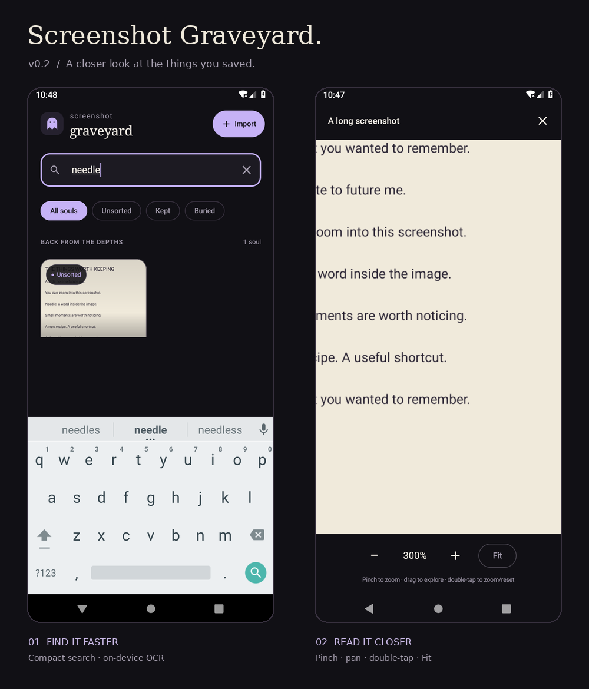

# Screenshot Graveyard

A little digital afterlife for the recipes, rabbit holes, and lines of code you meant to revisit.

Native Android · Kotlin · Jetpack Compose · Room FTS4 · on-device ML Kit OCR

[Project showcase](https://www.zelunhe.com/projects/screenshot-graveyard/) · [Download source](https://github.com/Zelun-He/screenshot-graveyard/archive/refs/heads/main.zip)



## What you can do

- Import selected images with Android's photo picker, or share images from another app.
- Search titles, tags, and recognized words **inside** screenshots.
- Open screenshots full screen, pinch to zoom, pan, double-tap to zoom/reset, or use accessible zoom and Fit buttons.
- Search in a compact layout that hides the large archive header as you type.
- Keep useful screenshots, bury finished ones, and revive them later.
- Review the oldest unsorted screenshot in a swipeable sorting ritual, with accessible button alternatives.
- Edit titles and tags, copy extracted text, and share images back out.
- Undo status changes. Permanently remove an archive copy through a separate confirmation.
- Explore six original sample screenshots without an account or API key.

The archive uses a dark ink, lavender, and sage palette with an original animated ghost illustration. Layouts scroll on small displays, adapt the grid to available width, respect system insets, and support system font scaling.

## Run it

1. Install Android Studio and open this folder as the project.
2. Use **JDK 17** for Gradle. Install Android SDK Platform **36** when prompted.
3. Let Gradle sync, then run `app` on an Android device or emulator running **Android 8.0 / API 26 or newer**.
4. Tap **Import**, or choose **explore a sample graveyard** on the empty archive screen.

On macOS/Linux:

```sh
chmod +x gradlew
./gradlew assembleDebug
./gradlew installDebug  # with an Android device/emulator connected
```

Windows: use `gradlew.bat`. The wrapper pins Gradle 8.13 and verifies the distribution SHA-256 checksum. The debug APK appears at `app/build/outputs/apk/debug/app-debug.apk`.

An Android app cannot be installed on an iPhone. You can develop this project on your Mac using Android Studio and an Android emulator.

## Downloadable Preview and existing installations

The 0.2.0 downloadable APK is **Screenshot Graveyard Preview**, using
`com.zelun.screenshotgraveyard.preview`. It installs alongside the original
`com.zelun.screenshotgraveyard` app, keeping the original archive intact.
The two apps have separate archives; no automatic migration is performed.

The source builds the normal package by default. To build the separate Preview:

```sh
./gradlew -PgraveyardPreviewInstall=true assembleDebug
```

Android requires the same signing key for in-place updates. A private
`Screenshot-Graveyard-development-signing.zip` backup is supplied separately
for future Preview builds. After extracting that backup, use its key explicitly:

```sh
./gradlew -PgraveyardPreviewInstall=true \
  -PgraveyardDebugKeystore=/absolute/path/debug.keystore assembleDebug
```

The debug-key password and alias follow Android's standard debug conventions.
Keep the backup private and outside the repository. It is a development key;
public releases need a separate production signing setup.

## How it works

1. A selected `content://` URI is streamed into a temporary file, bounded to 25 MB, validated as an image, and hashed with SHA-256.
2. A unique content hash prevents importing identical bytes twice. A private copy and a Room row are created.
3. A unique WorkManager job recognizes text with the **bundled Latin-script ML Kit model**. It downsamples large images and respects EXIF orientation.
4. Room maintains an external-content FTS4 index over the title, tags, and extracted text. Searches use lowercase alphanumeric word-prefix terms with whitespace for implicit AND, supporting Android's standard FTS4 parser. Raw FTS operators are not accepted from user input.
5. Compose observes database flows. Status changes use conditional updates, so stale actions or stale Undo operations cannot overwrite a more recent transition.

OCR retries transient failures with exponential backoff and resumes unfinished jobs on startup. Recognition is serialized and reuses one recognizer to bound memory and avoid repeated model initialization during large imports. Failed items have a manual retry action. OCR updates preserve user-edited titles and tags with conditional SQL, including intentionally cleared tags. Tag suggestions use a small, transparent keyword classifier; they are editable.

| Area | Location |
| --- | --- |
| Import, hashing, files, work scheduling | `app/src/main/java/com/zelun/screenshotgraveyard/data/` |
| Search normalization and archive rules | `app/src/main/java/com/zelun/screenshotgraveyard/domain/` |
| Zoom anchoring, aspect fit, and pan bounds | `app/src/main/java/com/zelun/screenshotgraveyard/domain/ImageViewport.kt` |
| Durable OCR | `app/src/main/java/com/zelun/screenshotgraveyard/worker/` |
| Screens, illustration, theme, ViewModel | `app/src/main/java/com/zelun/screenshotgraveyard/ui/` |
| Reproducible original sample assets | `tools/generate_samples.py` |

## Data and storage

Images and extracted text are stored in app-private files and a local SQLite database. No backend, account, API keys, or broad photo-library permission is required. The app removes the Internet permission from its merged manifest. Android backup is disabled.

Import creates a separate archive copy. **Bury is a reversible status change and does not reclaim storage.** Removing a copy deletes that archive image and its database record; it does not delete the original gallery image. Uninstalling clears the archive. Share sends only the image the user explicitly chooses, using a scoped FileProvider URI.

## Verification

```sh
./gradlew testDebugUnitTest lintDebug assembleDebug
./gradlew connectedDebugAndroidTest  # a connected emulator/device is required
```

- JVM tests cover safe FTS query construction, Unicode tokens, input bounds, title selection, tag normalization, and classification.
- Viewer geometry tests cover focal-point anchoring, pan limits, zoom limits, aspect ratios, resize behavior, double-tap, and invalid inputs.
- Room instrumentation tests cover FTS insert/update/delete synchronization, content-hash uniqueness, stale status updates, and persistence across database reopen.
- An end-to-end Compose test imports a real generated image, waits for actual OCR, searches recognized text, keeps/buries/revives it, then removes the archive copy while checking the source survives.
- A sample tour captures the archive, sorting ritual, and search screens.
- Viewer device tests perform an actual two-finger pinch, horizontal/vertical panning, double-tap, zoom-button and Fit actions, and return to the detail sheet. A separate check verifies that search results appear with the large header removed.
- GitHub Actions contains build/lint/unit-test and emulator-test jobs. It runs on pushes and pull requests in this repository.

See `docs/VALIDATION.md` for the checks actually completed for this delivery.

## Deliberately small first release

- OCR recognizes Latin script. Chinese, Japanese, Korean, and Devanagari models can be added separately.
- Search is lexical prefix search, not semantic or fuzzy search. All search terms must match somewhere in the same screenshot.
- Imports process up to 20 images per batch; each must be a readable image under 25 MB. Interrupted imports can be selected again; committed images are deduplicated and OCR resumes.
- There is no automatic gallery scanning, cloud sync, or original-gallery deletion.
- The sample cafe, event, and itinerary are fictional examples.
- Viewer zoom ranges from 1× to 8× relative to the fitted image. Viewer decoding is bounded to a 2048×4096 request; very long screenshots can be downsampled. This release does not use tiled decoding.
- This is a development release. A public store release still needs your production signing key, store listing, and a broader physical-device/accessibility test pass.

## Development tooling

Pinned toolchain: AGP 8.13.2, Kotlin/Compose compiler 2.2.21, Compose BOM 2025.10.01, Room 2.8.3, Java 17, compile/target SDK 36.

To regenerate the sample PNGs on Linux, install Pillow and run `python tools/generate_samples.py`. Normal app development does not need Python.

## License

MIT. See `LICENSE`. Third-party libraries retain their respective licenses. The Gradle wrapper scripts and JAR are distributed under the Gradle project's Apache 2.0 license.
